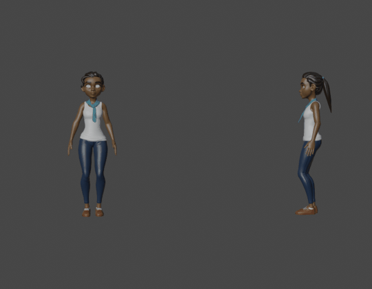
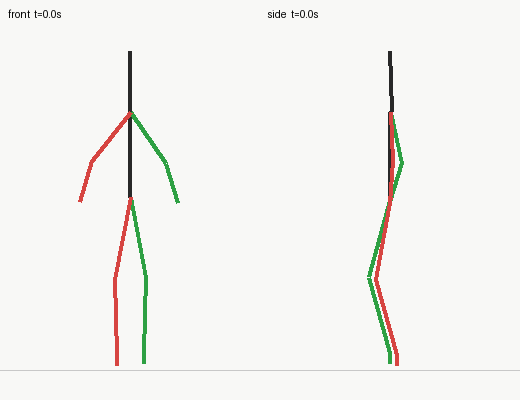
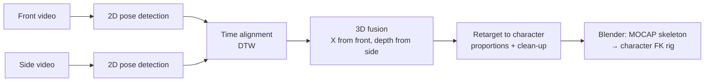
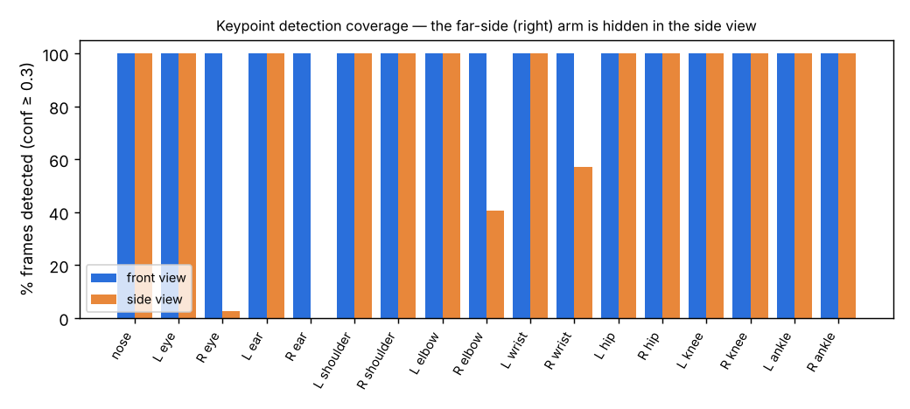
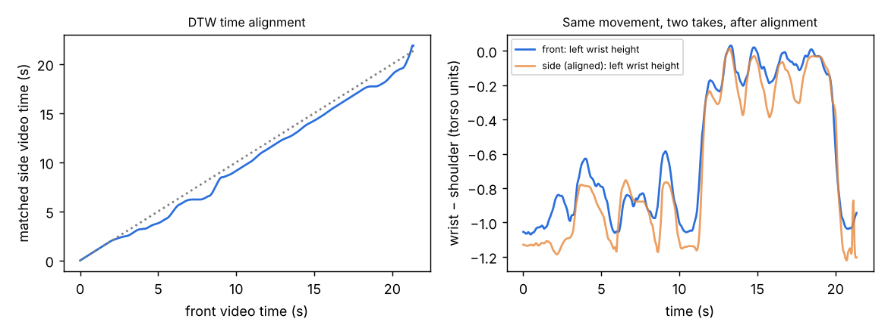
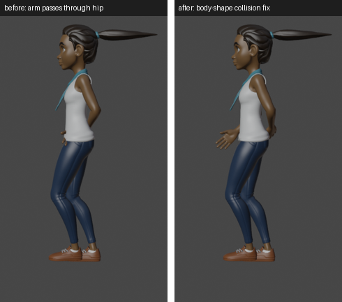
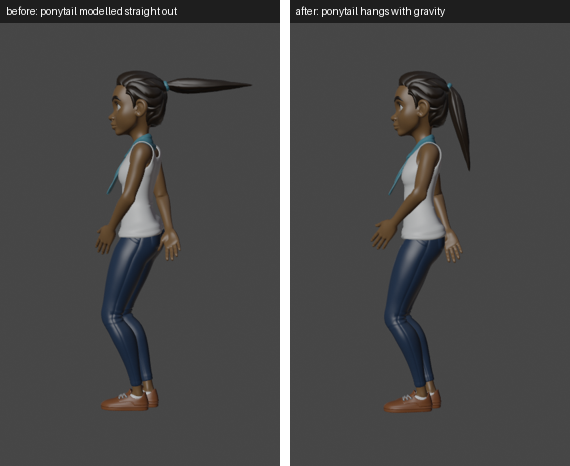
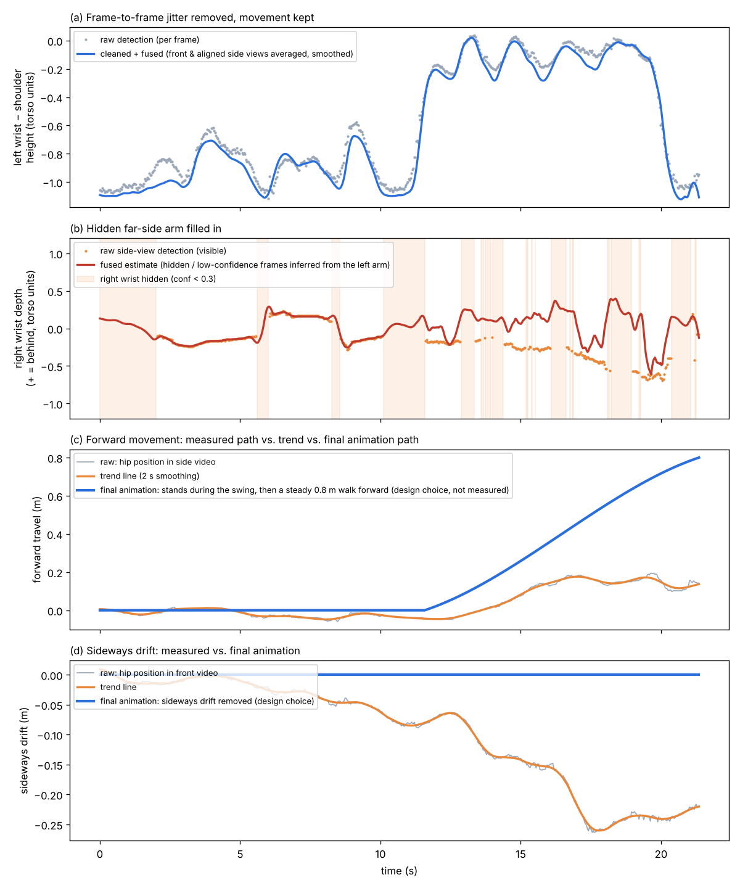

# Korean Dance Motion Capture → Blender

Turning two ordinary phone videos of a dance — one filmed from the **front**, one from the **side** — into 3D motion that drives a rigged character in Blender.

> **At a glance**
> - **What:** a low-cost 3D motion-capture pipeline built from two phones instead of a studio, applied to Korean dance.
> - **How:** 2D pose detection → DTW time alignment of the two takes → 3D fusion (sideways from the front view, depth from the side view) → retargeting to a character rig, with anatomy-aware clean-up.
> - **Result:** 641 frames (21 s) of fused 3D motion driving the Rain character in Blender. Front-view keypoints were detected in 100% of frames, and the aligned takes match closely (r = 0.98 on the wrist-height signal used for alignment).

<p align="center">
  <br>
  <em>The captured motion retargeted onto the Rain character (front | side).</em>
</p>

<p align="center">
  <br>
  <em>The fused 3D skeleton (green = left, red = right). The source videos aren't included in this repo for privacy.</em>
</p>

## Research journey

This repo is the latest step in a longer line of work on recovering 3D structure from images and reading meaning from human movement:

| # | Project | Type |
|---|---|---|
| 01 | [3D Reconstruction from Photos (Meshroom)](research/01-3d-reconstruction/) | School project, grade 10 |
| 02 | [Gait Recognition for Drone/CCTV Missing-Person Search](research/02-gait-recognition-drone/) | STEAM R&E 2024 (team of 2): DeepGaitV2 on a drone + Jetson Orin |
| 03 | [AI Gait Analysis for Early Alzheimer's Detection](research/03-gait-alzheimers/) | Team paper (KSFI), plus working gait-biomarker code |
| **04** | **Korean Dance Motion Capture → Blender** (this page) | **Ongoing, October 2026** |

See [research/](research/) for how each step led to the next and where the work is heading.

## Why

The goal is to record and teach Korean dance movement without a motion-capture studio. With a single camera, pose estimators only see two dimensions, so movement toward or away from the lens gets lost. This project tests a cheap fix: film the same routine twice, from the front and from the side, and combine the two views into 3D.

## Pipeline



| Step | Script | What it does |
|---|---|---|
| 1. Detect | `pipeline/detect.py` | Runs YOLO11x-pose on every frame and keeps 17 COCO keypoints with confidences for the main person. |
| 2. Sync + fuse | `pipeline/fuse.py` | The two takes were filmed separately, so their timing differs. The script cleans and smooths the keypoints, then aligns the side take to the front take with **dynamic time warping** on view-independent features such as wrist, elbow, knee and ankle heights. Left/right labels in the side view are resolved, and the two views are fused into 3D: **X** (sideways) from the front view, **Y** (depth) from the side view, **Z** (height) from both. |
| 3. Retarget | `pipeline/retarget.py` | Converts the fused motion into target points sized to a specific character's bone lengths. Optional clean-up passes are listed below. |
| 4. Build | `pipeline/build_blend.py` | Inside Blender, creates a `MOCAP_Skeleton` armature with the same rest layout as the character's FK controls, drives it with Damped/Locked Track constraints and bakes it to keyframes. The character's FK controls then copy its world rotations. |

### Retargeting clean-up options

Raw fused motion isn't automatically good animation. These options came out of reviewing renders against the reference video:

| Flag | Problem it addresses |
|---|---|
| `--body=body.json` | The character's torso is much wider than the dancer's, so measured hand positions ended up inside the body. Measured torso cross-sections (`export_body.py`) push arm segments back outside. |
| `--arm-limits` | Stops elbows from bending backward and limits how far the upper arm reaches behind the body. |
| `--swing-from-left` | The right arm is mostly hidden in the side view. During the opening arm swing it mirrors the clearly visible left arm, with the front/back swing reversed. |
| `--mirror-raised=L` | When both arms are raised, the right arm mirrors the left exactly. |
| `--swing-raise=45` | Rescales the sideways arm lift in the opening section to a target angle. |
| `--fixed-head` | Keeps the head facing forward. Face keypoints are noisy because the far ear is hidden in the side view. |
| `--face-front`, `--legs-sagittal`, `--forward=0.8` | Keeps the body facing front, the pelvis level and the legs bending only forward and back. Adds a steady forward travel that starts after the opening swing. |

## Results and problem solving

**1. One camera can't see depth, and a side camera can't see the far arm.**
The front view detects every keypoint in every frame. In the side view the right arm is behind the body: the right elbow is detected in only 41% of frames and the right ear in none. Fusion therefore takes depth from the side view only where it can be trusted, and otherwise infers the hidden arm from the visible one.

<p align="center"></p>

**2. The two takes were separate performances.**
The timing differs by up to 1.7 seconds between the takes. Dynamic time warping on view-independent signals (limb heights) maps every front frame to the matching side frame. After alignment, the same movement lines up across both videos.

<p align="center"></p>

**3. Accurate data still made bad animation, so the character's body had to be considered.**
The Rain character is much wider than the dancer, so correctly measured hand positions ended up inside her hips. Measuring the character's torso cross-sections and pushing arm segments outside them fixed this. A ponytail modelled sticking straight out was set to hang with gravity. Locked ankles, a level pelvis and limits on elbow and shoulder angles removed the remaining unnatural poses.

<p align="center"> &nbsp; </p>

**4. Raw detections vs. corrected motion.**
All curves below come from the real recording. Grey and orange are what the pose detector produced; blue and red are what the character uses.

<p align="center"></p>

| | Raw | Corrected |
|---|---|---|
| (a) Left-wrist height jitter (mean frame-to-frame 2nd difference) | 0.0184 | 0.0016 (≈11× smoother) |
| (b) Right wrist hidden in the side view | 38% of frames | filled in from the visible left arm |
| (c) Forward travel | ≈0.15 m measured, wobbly | 0.8 m steady walk after the opening swing (**animation choice**) |
| (d) Sideways drift | 0.27 m measured | removed so the character faces front (**animation choice**) |

(a) and (b) are corrections of measurement noise and occlusion. (c) and (d) are deliberate animation choices that depart from what was measured, and they are labelled that way in the figure.

**What I learned:** tracking accuracy and believable motion are different problems. The biggest improvements came from reviewing renders frame by frame against the reference video and turning each visual problem into a measurable constraint.

## Run it

Requirements: Python 3.11+, `pip install -r requirements.txt`, and Blender 4.1+ for the build step.

```bash
# 1. 2D keypoints (the YOLO weights download automatically)
python pipeline/detect.py front.mp4 data/front.npz
python pipeline/detect.py side.mp4  data/side.npz

# 2. sync + 3D fusion -> data/fused.npz
cd data && python ../pipeline/fuse.py

# 3. character rest pose + torso shape (run with Blender's Python or the `bpy` pip module)
python ../pipeline/export_rest.py rain_v3.2.blend ../profiles/rain.json rest_rain.json
python ../pipeline/export_body.py rain_v3.2.blend body_rain.json GEO-rain-body GEO-rain-jeans GEO-rain-top

# 4. retarget
python ../pipeline/retarget.py rest_rain.json targets_rain.json \
  --fixed-head --face-front --body=body_rain.json --mirror-raised=L \
  --swing-raise=45 --swing-from-left --arm-limits --legs-sagittal --forward=0.8

# 5. build the animated .blend with your own Blender
blender -b -y --python ../pipeline/build_blend.py -- rain_v3.2.blend ../profiles/rain.json targets_rain.json rain_mocap.blend
```

`data/` already contains the keypoints and intermediate results from the recording, so steps 2–5 run without the original videos. `scripts/run_rain.sh` runs step 5 and opens the result in Blender with autoplay.

### Using another character

Add a profile in `profiles/` that maps roles such as `hips`, `spine0…`, `upper.L` and `thigh.R` to that rig's FK control bones, plus its IK/FK switch properties. `profiles/victoria.json` is a second example.

## Repository layout

```
pipeline/   detection, fusion, retargeting, Blender build, render helpers
profiles/   bone mappings for each character rig
data/       keypoints and intermediate results from the recording (no video)
media/      result animations
scripts/    convenience launcher for macOS
research/   earlier projects (01–03) and gait-biomarker code
```

## Limitations and next steps

- The two takes are separate performances, so the timing alignment is approximate and the arm depth is a compromise between them. Recording both views at the same time with two phones would remove this problem.
- COCO keypoints have no hands, fingers or toes, so wrists and feet are held in neutral poses.
- Feet glide rather than step. Proper foot contact and stepping are next.
- This version uses YOLO11-pose for 2D detection; MediaPipe was planned, but its model files couldn't be downloaded in the build environment. Comparing estimators on the same footage is future work.

## Credits

- **Rain** character rig: [Blender Studio](https://studio.blender.org), CC-BY 4.0. The character files are not redistributed here; download Rain from Blender Studio.
- Pose estimation: [Ultralytics YOLO11](https://github.com/ultralytics/ultralytics).
- Built in October 2026 with help from Claude (Anthropic), an AI assistant, for code generation and debugging. I directed the project and reviewed each iteration of the animation against the reference video.

## License

Code: MIT (see `LICENSE`).
