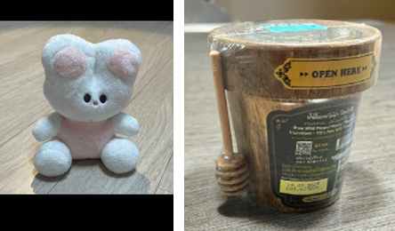
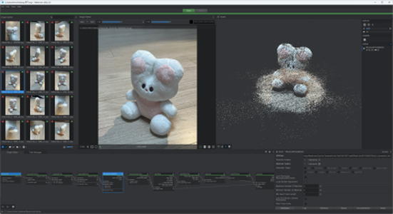
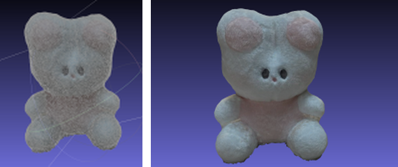
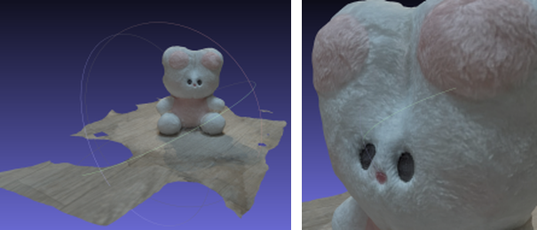
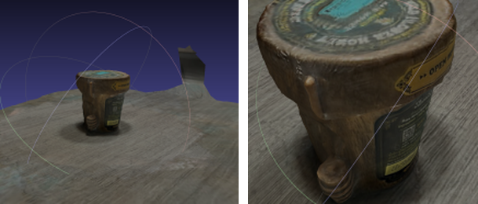

# 01 · 3D Reconstruction from Photos (Meshroom)

*School convergence project, grade 10. Summarized in English from the Korean report.*

## Question
Can usable 3D models for games and avatars be built from ordinary photos instead of modeling them by hand? And which conditions keep reconstruction errors to a minimum?

## Method
Research procedure: **choose objects and photograph them → 3D reconstruction → check and analyze the results.**

**1. Photographing the objects.** Two objects were chosen to contrast surface types: a matte, fuzzy stuffed rabbit and a honey jar wrapped in clear plastic, with a thin wooden dipper. They were photographed from all around with a phone in bright lighting: **38 photos** of the rabbit and **30** of the jar. All photos were resized to 1080×1440.

**2. Reconstruction in Meshroom (open source), with MeshLab for viewing and clean-up.** Meshroom runs five stages:

| Stage | What happens |
|---|---|
| Feature extraction | Finds distinctive points in each photo. |
| Feature matching | Finds the same points across different photos. |
| Sparse reconstruction | Estimates where the camera was for each photo and triangulates a sparse 3D point cloud. |
| Meshing | Connects neighboring points of the dense cloud into a triangle mesh. |
| Texturing | Projects the best-matching photo onto each face of the mesh, using the camera poses. |

 <em>Meshroom: the 38 input photos (left) and the reconstructed scene (right)</em>

 <em>Mesh before (left) and after (right) texturing</em>

## Results
**Stuffed rabbit: success.** The model kept the overall shape and even the texture of the fur.

**Plastic-wrapped honey jar: partial failure.** The clear wrap distorted the outer surface, and part of the thin dipper disappeared.

## Analysis
Photogrammetry depends on finding the *same* visible feature in many photos. The rabbit's matte, textured surface gives plenty of stable features. Clear plastic shows the background through it and reflects light differently from every angle, so features don't match between photos. A thin stick gets too few matched points to form a surface. For game assets, this means photo-based modeling works well for opaque, textured objects. Transparent, shiny and very thin parts need extra steps, such as matte spray, more photos or manual repair.

## What it led to
The core idea, recovering 3D structure from several 2D views, comes back in [04 · dance motion capture](../../README.md). There, two 2D camera views of a moving body are combined into 3D motion, and the same lesson applies: 3D is only as good as what both views can actually see.
