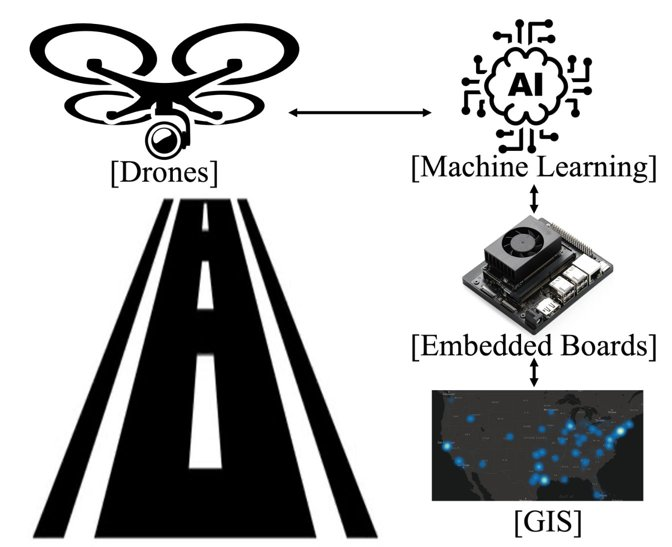
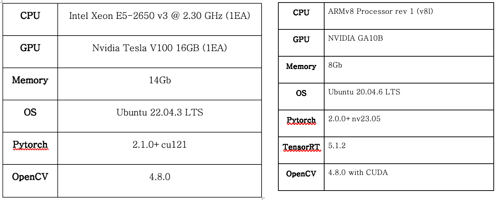

# 02 · Gait Recognition for Drone/CCTV Missing-Person Search

*School STEAM R&E project (2024), team of two students with a supervising teacher. Summarized in English from the Korean research poster and planning notes.*

## Problem
In 2022, about 750,000 older adults with dementia and 280,000 people with developmental disabilities were registered in South Korea. About 12,000 and 8,000 missing-person cases, respectively, were reported for these groups. Current search tools have clear weaknesses. GPS trackers are uncomfortable and get taken off. Face recognition fails at a distance, at low resolution and in CCTV blind spots. Gapyeong County, where the school is, has sparse CCTV coverage, which makes searches harder. Expert interviews added another detail: people with dementia often take public transport and are found far from familiar areas.

**Idea:** recognize a person by *how they walk*. Gait still works at a distance and doesn't need a visible face, so a drone can extend coverage where CCTV is missing.

## From plan to system
The project began as a planning document on **anomaly detection** for wandering behavior: a convolutional autoencoder trained on normal behavior, using the AI Hub senior and CCTV abnormal-behavior video sets. The focus then narrowed to **gait recognition**, so that a drone could find one specific missing person.

## Method
- **Data:** GREW, GaitLU-1M, SUSTech1K and DroneGait (aerial views) for varied environments, clothing and viewpoints. The data was split 80/20 into training and test sets, with K-fold cross-validation.
- **Model:** DeepGaitV2-3D from the OpenGait framework, with transfer learning. Mosaic, Mixup and HSV augmentation were used against overfitting and dataset imbalance.
- **Hardware:** training on a server with a Tesla V100 GPU. Real-time inference on an NVIDIA Jetson Orin board with TensorRT, fed by drone video at 720p.

 <em>Drone used for field data collection</em>

 <em>Training server (left) and Jetson Orin edge device (right)</em>

## Results
| Model | Data | Rank-1 accuracy |
|---|---|---|
| DeepGaitV2-3D (C=128) | Merged dataset (team's training run) | **75.3%** |
| DeepGaitV2-3D (C=128) | Gait3D / GREW, as published by OpenGait (Fan et al., 2023), for reference | 75.8% / 81.6% |

- Real-time gait recognition ran on the Orin board from live drone footage.
- Recognition stayed stable under changing light and clothing in outdoor tests.
- Main limits: drone battery life and video resolution.

## What it led to
This project moved the focus from *who* is walking to *how* someone walks. That shift leads directly to [03 · gait analysis for early Alzheimer's detection](../03-gait-alzheimers/), where changes in a person's own gait over time become an early health signal.
