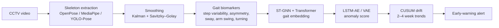
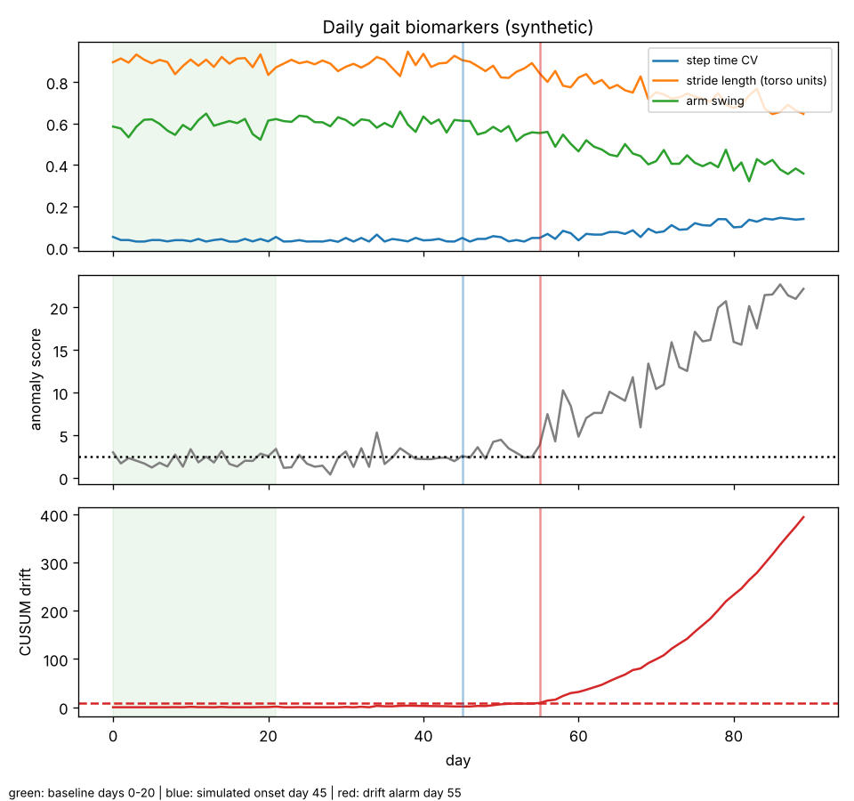

# 03 · AI Gait Analysis for Early Alzheimer's Detection

*Team research paper presented at the KSFI International STEAM competition. Summary below; the full paper is available on request.*

## Motivation
In South Korea, about 10% of adults over 65 live with dementia, and more than half of them live alone (*Status of Dementia in Korea 2018*). The study focuses on **Gapyeong County**, a rural area where many elderly residents live alone and far from medical care. Clinical studies link Alzheimer's progression to changes in gait, such as slower speed, shorter steps, more variable step timing, asymmetry, sway and reduced arm swing. These changes can show up before obvious cognitive symptoms. The paper reverses that link: **watch gait to flag early cognitive decline**, using skeleton-only data so no faces or appearance are stored.

## Proposed framework

- **Skeleton-only input:** keeps privacy and reduces sensitivity to lighting and background.
- **Environment correction:** proposed corrections for weather, slope, camera angle and lighting, so outside conditions aren't mistaken for decline.
- **Drift over time:** single noisy days are ignored. Only deterioration sustained over weeks raises the risk score.

## Status of the results
The paper's experiments ran the proposed framework on a **synthetic simulation**, with gait deterioration injected into generated sequences. The reported figures, such as accuracy and early-detection lead time, come from that setting. They have **not** been validated on real patient data, and that validation is the main open step.

## Working code (added October 2026)
To move the framework from paper to code, this folder now contains a runnable implementation of its first stages:

| File | What it does |
|---|---|
| [`code/gait_features.py`](code/gait_features.py) | Computes the paper's gait biomarkers (cadence, step time variability, step time and step length asymmetry, stride length, sway, arm swing and its asymmetry) from COCO-17 (YOLO) or MediaPipe-33 keypoints. A synthetic stick-figure walker checks the outputs. |
| [`code/drift_demo.py`](code/drift_demo.py) | Simulates 90 days of recordings with gradual deterioration starting on day 45, scores each day against a 3-week baseline and runs CUSUM drift detection. |

<p align="center"></p>

On this **synthetic** run, the drift alarm triggers on day 55, ten days after the simulated onset, with no alarms before onset. The demo uses a simple statistical baseline (Mahalanobis distance) in place of the paper's LSTM autoencoder, so it runs anywhere. It only shows that the pipeline works end to end, not that it is clinically accurate.

```bash
cd code
python gait_features.py   # biomarkers for a normal vs an impaired synthetic walker
python drift_demo.py      # writes figures/drift_demo.png
```

## Next steps
1. Run `gait_features.py` on real walking videos, starting with consenting volunteers, through the same pose pipeline used in [04](../../README.md).
2. Replace the baseline scorer with the LSTM autoencoder / VAE and compare.
3. Validate on public gait datasets before making any claims about clinical accuracy.
